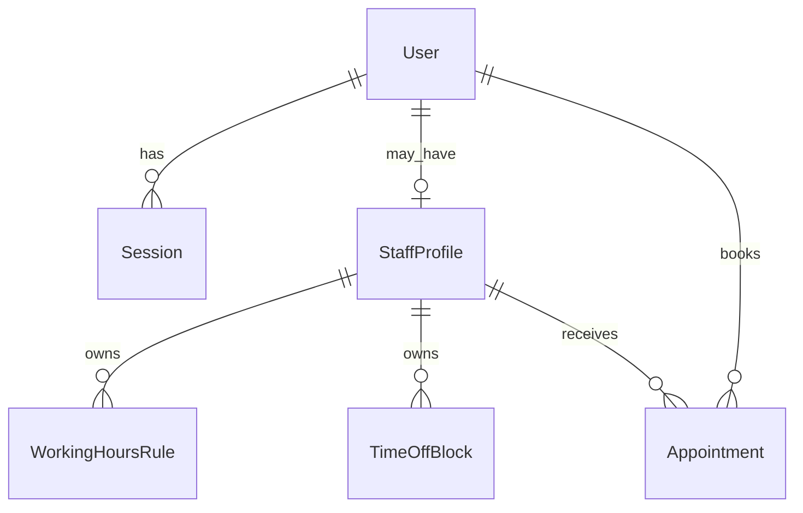

# Domain Model

Entity ownership and logic:

- `User`
  - Schema: `prisma/schema.prisma`
  - Primary service: `src/services/authService.ts`
  - Important repository: `src/repositories/userRepository.ts`
- `Session`
  - Schema: `prisma/schema.prisma`
  - Primary service: `src/services/authService.ts`
  - Important repository: `src/repositories/sessionRepository.ts`
- `StaffProfile`
  - Schema: `prisma/schema.prisma`
  - Primary service: `src/services/availabilityService.ts`
  - Important repository: `src/repositories/staffRepository.ts`
- `WorkingHoursRule`
  - Schema: `prisma/schema.prisma`
  - Primary service: `src/services/availabilityService.ts`
  - Important repository: `src/repositories/availabilityRepository.ts`
- `TimeOffBlock`
  - Schema: `prisma/schema.prisma`
  - Primary service: `src/services/availabilityService.ts`
  - Important repository: `src/repositories/availabilityRepository.ts`
- `Appointment`
  - Schema: `prisma/schema.prisma`
  - Primary service: `src/services/appointmentService.ts`
  - Important repository: `src/repositories/appointmentRepository.ts`

Notes on the model:

- `Appointment.status` is the state machine input for cancellation logic in `src/services/appointmentService.ts`.
- `StaffProfile.appointmentDurationMinutes` drives slot length in `src/lib/availability/schedule.ts`.
- The overlap prevention rule is enforced again in PostgreSQL by `prisma/migrations/0001_initial/migration.sql` using an exclusion constraint.
- Appointment status is only `BOOKED` or `CANCELLED` in practice: booking creates `BOOKED`, cancellation moves it to
  `CANCELLED` with a reason and `cancelledAt` (`src/repositories/appointmentRepository.ts:156`). Cancelled rows keep their
  times for history but no longer block the calendar (the overlap reads and the exclusion constraint consider `BOOKED` only).
- Appointment length is not chosen by the client: `endsAt = startsAt + staff.appointmentDurationMinutes`
  (`src/services/appointmentService.ts:38-39`).
- This project does not include multi-tenancy. Every query scopes by user or staff ownership instead. To add tenancy later, `tenantId` would need to be added to the entities above and threaded through `src/lib/data/appointmentScopes.ts` and all repository filters.
